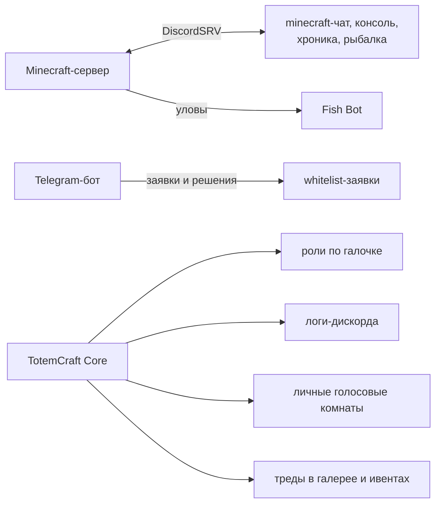

# Discord: боты и устройство сервера

Discord у нас не просто чат, а часть сервера: туда идёт игровой чат, оттуда выдаются роли, там форум с жалобами и заявками. Ниже что за что отвечает.

## Боты

| Бот | Что делает | Где работает |
|---|---|---|
| TotemCraft \| Игровой чат | Плагин DiscordSRV: чат игры и Discord в обе стороны, консоль, события и уловы | на Minecraft-сервере |
| Fish Bot | Трофейные рыбы, `/claim`, рейтинг | VPS, служба `fishbot`, [документация](/docs/gameplay/Custom%20fishing%20system.md) |
| TotemCraft \| Core | Роли, журнал, голосовые комнаты, треды | VPS, служба `totemcraftcore`, [код](/bots/discord/TotemCraftCore) |
| TotemCraft \| Ванильный сервер | Ответы администрации на форуме | без отдельной службы |
| Telegram-бот | Пишет в Discord о заявках на вайтлист и решениях | VPS, [документация](/docs/telegram%20bot/docs.md) |

## TotemCraft Core

До сентября 2026 эти задачи делал сторонний бот Lacuna. Он закрылся, роли пришлось выдавать вручную, журнал перестал писаться. Свой бот повторяет его поведение и занимает около 50 МБ памяти:

- реакция ✅ в `⭐┃регистрация` выдаёт роли «Verified» и «Игрок сервера»;
- журнал в `📒┃логи-дискорда`: правки и удаления сообщений, ветки, каналы, роли, баны и муты. Изменения каналов ботами не пишутся: DiscordSRV каждые 10 минут обновляет описание чата с онлайном;
- заход в `🔊┃войсчат` создаёт личную комнату игрока, пустая комната удаляется;
- под постом в `🎨┃галерея` создаётся тред и ставится 👍, под анонсом в `🎯┃ивенты` тред для записи.

Подробности и настройка в [README бота](/bots/discord/TotemCraftCore/README.md).

## Форум

Все обращения идут в канал-форум, у каждой темы тег: жалоба на игроков, на админов, заявка на разбан, на клан, на должность, идея, вопрос. В закрепе три формы: жалоба, разрешение на крупный механизм, разбан. Жалоба не по форме или без доказательств не рассматривается. Решённую тему администрация закрывает.

## Кланы

У каждого клана из игры (плагин SimpleClans) в Discord есть роль `Клан: <название>` и своя категория с текстовым и голосовым каналом. Категорию видит только роль клана: у `@everyone` запрещены просмотр и вход, у роли клана разрешены.
